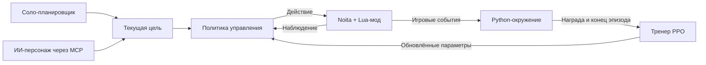

# Архитектура

Одна политика управления может выполнять разные задачи на входе. Соло-планировщик задаёт следующую цель прохождения, а ИИ-напарник выбирает задачу в зависимости от действий человека и ситуации в игре. Специализированные политики движения или боя можно добавить, если эксперименты покажут, что совместное обучение ухудшает отдельные навыки.

## Игра и окружение

Первая сборка рассчитана на локальную GOG-установку. Lua-мод читает компоненты игрока и события, записывает управление в `ControlsComponent` и обменивается сообщениями с Python через локальный IPC. В Entangled Worlds есть пример такого управления в `files/system/notplayer_ai/notplayer_ai.lua`. Конкретный транспорт и порядок игровых хуков определим после проверки в игре. [Entangled Worlds](https://github.com/IntQuant/noita_entangled_worlds)

Python предоставляет `reset(seed, scenario)` и `step(action)`. Сообщения содержат идентификатор эпизода и номер кадра. На первом запуске пробуем удерживать действие четыре кадра. Если движок продолжает симуляцию во время ожидания команды, фиксируем фактическую длительность перехода и проверяем её разброс. Смерть и достижение цели завершают эпизод, а лимит времени учитывается как усечение. Разрыв связи фиксируется как ошибка среды.

## Наблюдения и действия

- **Наблюдение.** HP, скорость, левитация, состояние активного жезла, локальные лучи до препятствий и направление к заданной цели. Для боевых сценариев добавляем ближайших видимых врагов и снаряды. Растр и материалы вводим по результатам первых прогонов.
- **Действие.** Горизонтальное движение, левитация, огонь и один из 16 углов прицела. Переключение жезлов и взаимодействия добавляем в сценариях, где они нужны.
- **Цель.** Тип задачи и параметры. Со временем это может быть точка, игрок, цель для атаки или направление поиска. Точное положение скрытого портала допустимо в учебном сценарии с заданной целью. В сценарии поиска портал обнаруживается по локальным наблюдениям.
- **Награда.** События из игры переводятся в награду на стороне Python. На первом маршруте награждаем за достижение портала и слегка штрафуем за время и потерю HP.

## Соло и кооп

В соло окружение владеет запуском и сбросом сценария, а планировщик выбирает цель с учётом текущей стадии забега. Выбор жезлов и перков для первых полных забегов можно реализовать правилами.

В коопе агент запускается отдельным участником лобби. MCP отдаёт статус и принимает высокоуровневые задачи вроде `follow(player)` и `hold(position)`. Политика отрабатывает их в игровом цикле. Сначала нужно подтвердить совместимость управления и синхронизацию действий со вторым клиентом.
